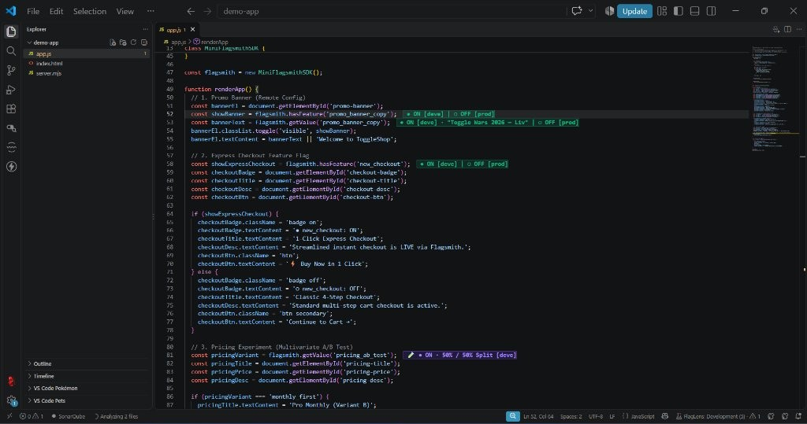
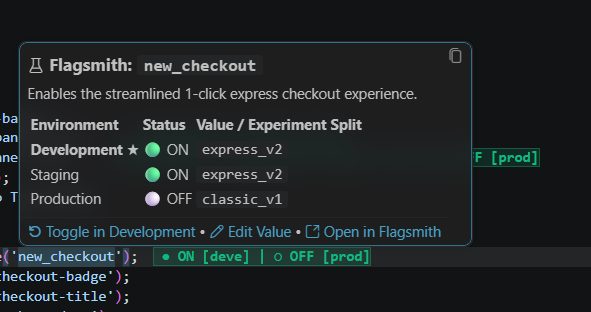
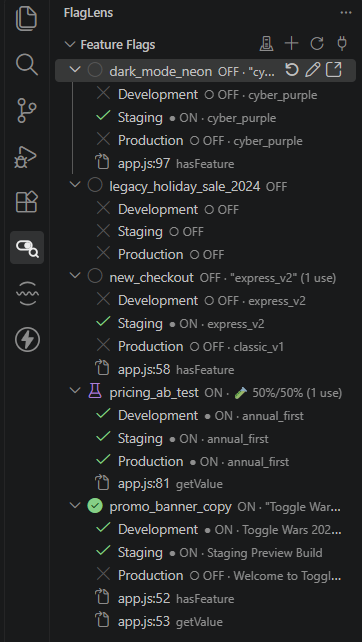
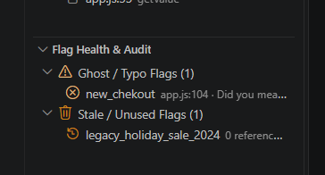
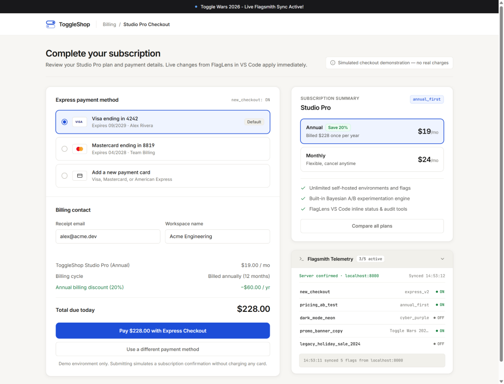
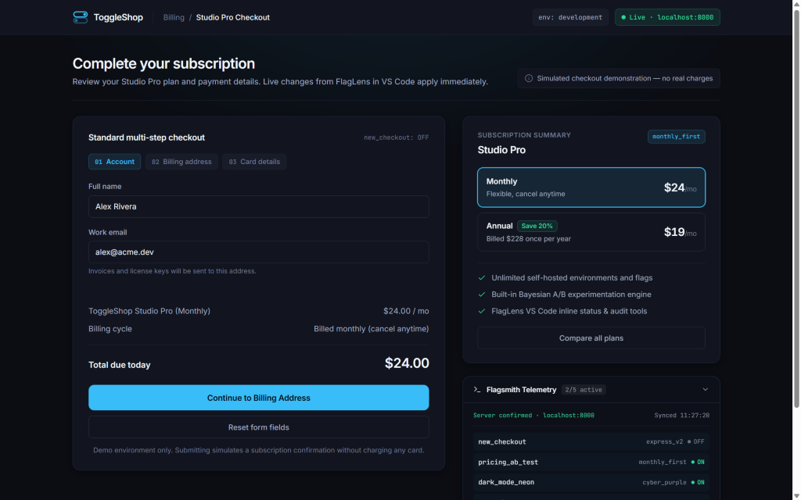

<div align="center">


# FlagLens

**Live feature flag inspection, 1-click toggles, experiment visibility, and codebase auditing for self-hosted [Flagsmith](https://github.com/Flagsmith/flagsmith) — directly inside VS Code.**

[](https://code.visualstudio.com/)
[](https://github.com/Flagsmith/flagsmith)
[](https://www.typescriptlang.org/)
[](LICENSE)

*Built for **Toggle Wars: The Flagsmith Experimentation Hackathon** — Track 03: Build on Open Source Flagsmith*

</div>

---

## Live Links & Installation

| Resource | Link |
| :--- | :--- |
| **VS Code Marketplace** | *[Add VS Code Marketplace URL here]* *(or install [`flaglens-1.0.0.vsix`](flaglens-1.0.0.vsix))* |
| **Live Demo Storefront (Vercel)** | **[flaglens-demo-app.vercel.app](https://flaglens-demo-app.vercel.app/)** |
| **Demo Video (2 min)** | *[Add YouTube / Loom Demo Video URL here]* |

---

## VS Code Marketplace

Install **FlagLens** directly from the Visual Studio Code Marketplace (or via `code --install-extension flaglens-1.0.0.vsix`):

<!-- Paste Marketplace screenshot at docs/screenshots/07-vscode-marketplace.png -->
> *VS Code Marketplace screenshot coming soon — upload to `docs/screenshots/07-vscode-marketplace.png`.*

---

## Overview

Shipping features behind feature flags usually forces engineers to constantly alt-tab between their editor and the Flagsmith dashboard just to check whether a flag is enabled in Development vs. Production, inspect multivariate A/B split weights, verify spelling, or hunt down stale flags.

**FlagLens** eliminates that context switch by bringing your self-hosted open-source Flagsmith instance straight into VS Code—with live inline status badges, cross-environment hover controls, 1-click code wrapping, and automatic Ghost & Stale flag diagnostics.

---

## Screenshots

### Inline Live Status & Experiment Split Badges
Live `ON`/`OFF` states across environments, remote config values, multivariate A/B split percentages, and inline Ghost Flag warnings appear directly beside your Flagsmith SDK calls.



### Cross-Environment Hover Card & 1-Click Toggle
Hover over any flag identifier in code to inspect its description and state across **Development**, **Staging**, and **Production**, then toggle the flag or edit its remote config value without leaving the editor.



### Sidebar Explorer & Flag Health Audit
Browse all flags, jump directly to every file and line reference, catch typos (**Ghost Flags**) with 1-click Levenshtein Quick Fixes, and surface **Stale / Unused Flags** with zero workspace references.

| Feature Flags Explorer | Flag Health & Audit |
| :---: | :---: |
|  |  |

### Live Demo Storefront (`ToggleShop`)
Included in `demo-app/` to demonstrate real-time Flagsmith synchronization: toggling `new_checkout`, `pricing_ab_test`, `dark_mode_neon`, or `promo_banner_copy` in VS Code updates the storefront immediately without a redeploy.

| Light Mode · Express Checkout · Annual Variant | Dark Cyber Mode · 3-Step Checkout · Monthly Variant |
| :---: | :---: |
|  |  |

---

## Key Capabilities

| Capability | Description |
| :--- | :--- |
| **Inline Live Badges** | Detects `hasFeature`, `getValue`, `useFlags`, `is_feature_enabled`, `IsFeatureEnabled`, and `GetFeatureValue` across JS/TS, React, Python, Go, Java, and Dart. |
| **1-Click Hover Actions** | Cross-environment state matrix with direct **`Toggle`**, **`Edit Value`**, and **`Open in Flagsmith`** commands. |
| **Wrap Selection in Flag** | Highlight any block of code → Right-click or `Ctrl+.` → wraps the code in `if (flagsmith.hasFeature('...'))` and creates the flag in Flagsmith automatically. |
| **Ghost Flag Diagnostics** | Underlines unknown/misspelled flag names with 1-click Quick Fixes (`Replace with "new_checkout"` via Levenshtein matching, or `Create flag in Flagsmith`). |
| **Stale Flag Detection** | Scans your workspace and lists flags in Flagsmith with `0` code references to help eliminate flag debt. |
| **Zero-Setup Local Sandbox** | Connects to your self-hosted Flagsmith (`localhost:8000`) automatically, or starts an embedded Flagsmith-compatible sandbox if no external server is running. |
| **v1 & v2 API Support** | Works with Organisation API Keys (`Api-Key ser.*`), Admin `Token` auth, multivariate splits, and both Flagsmith v1 and Feature Versioning v2 environments. |

---

## Quick Start

### Option 1: Install & Try Instantly (Zero Setup)

```bash
# 1. Install the pre-packaged extension in VS Code
code --install-extension flaglens-1.0.0.vsix

# 2. Open the included demo workspace in VS Code
code demo-app
```

Open `demo-app/app.js` (lines 188–248). FlagLens automatically starts its embedded local Flagsmith sandbox on `http://localhost:8000` if no external Flagsmith instance is running.

To watch the live **ToggleShop** storefront respond to your VS Code toggles:
```bash
npm run demo-app
# Open http://localhost:3000
```

### Option 2: Connect to Self-Hosted Flagsmith (Docker)

FlagLens ships with Flagsmith's official Docker Compose configuration (PostgreSQL + Flagsmith API/UI + Task Processor, with Experimentation enabled by default):

```bash
# 1. Start self-hosted open-source Flagsmith on http://localhost:8000
cd docker
docker compose up -d

# 2. Create an account + project at http://localhost:8000 and generate an Organisation API Key (ser.*)

# 3. Seed the ToggleShop sample flags into your self-hosted instance
FLAGSMITH_URL=http://localhost:8000 FLAGSMITH_TOKEN=ser.YOUR_API_KEY node seed.mjs
```

In VS Code, click the **Configure Connection** (`🔌`) icon in the FlagLens sidebar and enter `http://localhost:8000` with your `ser.*` API key.

---

## How Flagsmith Is Integrated

- **Self-Hosted Deployment (`docker/docker-compose.yml` & `docker/seed.mjs`):** Spins up open-source Flagsmith locally with Experimentation enabled and seeds 5 sample flags (`new_checkout`, `pricing_ab_test`, `dark_mode_neon`, `promo_banner_copy`, and `legacy_holiday_sale_2024`).
- **Flagsmith Management REST API (`src/flagsmithClient.ts`):** Consumes `/api/v1/projects/`, `/api/v1/environments/`, `/api/v1/projects/{id}/features/`, and `/api/v1/environments/{env_key}/featurestates/`, and writes updates via `PUT` (with automatic fallback to Feature Versioning v2 `/versions/` + `/publish/`).
- **Flagsmith Client API (`demo-app/app.js`):** Polls `/api/v1/flags/` with `X-Environment-Key` to reflect live flag toggles and A/B experiment variants in real time.

---

## Configuration & Commands

### Settings

| Setting | Default | Description |
| :--- | :--- | :--- |
| `flaglens.apiUrl` | `http://localhost:8000` | Base URL of your self-hosted Flagsmith or Flagsmith Cloud instance |
| `flaglens.apiToken` | `flaglens-dev-token` | Flagsmith Organisation API Key (`ser.*`) or Admin Token |
| `flaglens.projectId` | `0` | Flagsmith Project ID (`0` auto-selects the first project) |
| `flaglens.defaultEnvironment` | `Development` | Default environment shown in inline badges and sidebar |
| `flaglens.autoRefreshSeconds` | `15` | Polling interval in seconds (`0` disables auto-polling) |
| `flaglens.showInlineBadges` | `true` | Toggle inline end-of-line status and experiment split badges |
| `flaglens.autoStartLocalSandbox` | `true` | Auto-start embedded local sandbox when `localhost:8000` is offline |

### Commands

- `FlagLens: Switch Active Environment`
- `FlagLens: Create New Feature Flag`
- `FlagLens: Toggle Feature Flag`
- `FlagLens: Edit Flag Remote Config Value`
- `FlagLens: Wrap Selection in Flagsmith Flag`
- `FlagLens: Refresh Flags`
- `FlagLens: Open in Flagsmith Dashboard`
- `FlagLens: Configure Self-Hosted Connection`
- `FlagLens: Start / Stop Built-in Local Sandbox`

---

## Repository Structure

```text
FlagLens/
├── src/
│   ├── extension.ts            # Extension entry point, commands & wrap-in-flag refactor
│   ├── flagsmithClient.ts      # Flagsmith Management API client (v1 + v2 fallback)
│   ├── flagScanner.ts          # Multi-language SDK call scanner & Levenshtein matcher
│   ├── flagStore.ts            # Reactive flag store, polling & workspace health audit
│   ├── localSandbox.ts         # Embedded zero-setup Flagsmith-compatible local sandbox
│   ├── decorationProvider.ts   # Inline status, A/B split & ghost flag decorations
│   ├── hoverProvider.ts        # Cross-environment hover cards & 1-click actions
│   ├── diagnosticsProvider.ts  # Ghost flag diagnostics, Quick Fixes & code actions
│   ├── sidebarProvider.ts      # Feature Flags & Flag Health TreeView providers
│   └── statusBar.ts            # Status bar environment switcher & health summary
├── docker/
│   ├── docker-compose.yml      # Official self-hosted Flagsmith Docker Compose stack
│   ├── seed.mjs                # Seeds sample flags into self-hosted Flagsmith
│   └── mock-flagsmith.mjs      # Standalone local Flagsmith-compatible API server
├── demo-app/                   # ToggleShop storefront wired to localhost:8000
├── tests/core.test.mjs         # Unit & end-to-end integration tests
├── media/                      # Extension icon (icon.png) & Activity Bar icon (icon.svg)
└── flaglens-1.0.0.vsix         # Pre-built installable VS Code extension package
```

---

## Development & Testing

```bash
npm install       # Install dev dependencies
npm run compile   # Compile TypeScript (src/ -> out/)
npm test          # Run scanner, fuzzy-match & Flagsmith API integration tests
npm run package   # Build flaglens-1.0.0.vsix
```

Press **`F5`** in VS Code to launch the Extension Development Host directly against `demo-app/`.

---

## License

[MIT](LICENSE)
