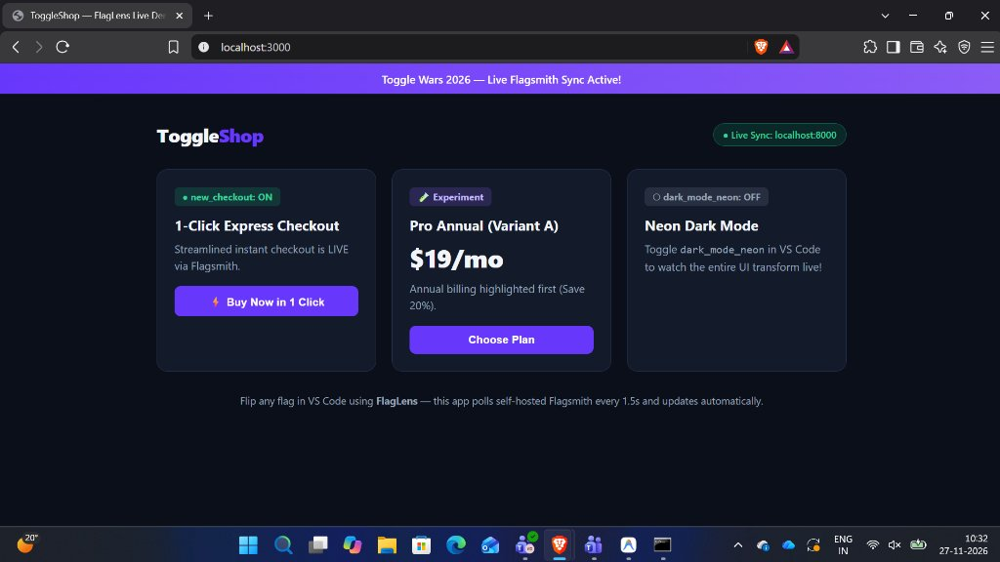

# FlagLens — Live Feature Flag & Experimentation Companion for VS Code

> **Built for Toggle Wars: The Flagsmith Experimentation Hackathon — Track 03: Build on Open Source Flagsmith**

**FlagLens** brings your **self-hosted open-source Flagsmith** instance directly into VS Code—so you can see live flag states, inspect A/B experiment splits, toggle flags across environments, wrap code in new flags, and catch typo/stale flags without ever leaving your editor.

---

## Live Screenshots

### 1. Inline Live Status & Experiment Split Badges


### 2. Cross-Environment Hover Card + 1-Click Toggle


### 3. Feature Flags Sidebar Explorer & Flag Health Audit
| Feature Flags Explorer | Ghost & Stale Flag Audit |
| :---: | :---: |
|  |  |

### 4. ToggleShop Live Demo App (`http://localhost:3000`)


> **Demo Video:** See [DEMO_SCRIPT.md](DEMO_SCRIPT.md) for the full 2-minute walkthrough *(add your YouTube / Loom demo link here before submitting)*.

---

## Highlights (Works Instantly Out of the Box)

- **Zero-Setup Auto-Start Local Sandbox:** The moment you install FlagLens and open VS Code, it connects to your self-hosted Flagsmith (`http://localhost:8000`). If no external server is running yet, FlagLens **automatically starts its own built-in Flagsmith-compatible sandbox**—zero terminals required!
- **Inline Live Status & Experiment Badges:** Detects Flagsmith SDK calls (`hasFeature`, `getValue`, `useFlags`, `is_feature_enabled`, `IsFeatureEnabled`, etc.) across JS/TS, React, Python, Go, Java, and Dart and renders live end-of-line pills:
  - Standard flag: `● ON [dev] | ○ OFF [prod]`
  - Remote config value: `● ON [dev] · "express_v2" | ○ OFF [prod]`
  - Multivariate / A/B Experiment: `🧪 ● ON · 50% / 50% Split [dev]`
  - Unknown / Typo flag: `⚠ Ghost Flag — Did you mean "new_checkout"?`
- **Rich Cross-Environment Hover Cards + 1-Click Toggles:** Hover over any flag name in your code to see its description, live status across **Development, Staging, and Production**, and clickable buttons right inside the tooltip:
  - **`Toggle in Development`** · **`Edit Value`** · **`Open in Flagsmith`**
- **1-Click "Wrap Selection in Flagsmith Flag":** Highlight any block of code → Right-click (or `Ctrl+.`) → **Wrap Selection in Flagsmith Feature Flag**. FlagLens wraps your code in `if (flagsmith.hasFeature('...')) { ... }` **and creates the flag in Flagsmith automatically**.
- **Ghost & Stale Flag Health Audit:**
  - **Ghost Flags (Typos):** Yellow squiggly diagnostics on flags referenced in code that don't exist in Flagsmith, with 1-click Quick Fixes (`Replace with "new_checkout"` via Levenshtein fuzzy matching, or `Create flag in Flagsmith`).
  - **Stale / Unused Flags:** Surfaces flags in Flagsmith that have `0` references across your workspace so teams can clean up flag debt.
- **Activity Bar Sidebar & Status Bar:**
  - **Switch Environment** (`Development` / `Staging` / `Production`)
  - **Create New Flag** (`+`) directly from VS Code
  - **Refresh Flags** (`↻`) & re-scan workspace health
  - **Configure Connection** (`🔌`) to point to any self-hosted Flagsmith or Flagsmith Cloud URL
  - Click any flag usage (`app.js:58`) to jump straight to that line of code.
- **Full Flagsmith API Compatibility:** Supports Organisation API Keys (`Api-Key ser.*`), Admin `Token` auth, multivariate splits, and both **Flagsmith v1** and **Feature Versioning v2** environments.

---

## How Flagsmith Is Used

FlagLens is built around **open-source, self-hosted Flagsmith**:
1. **Official Self-Hosted Stack (`docker/docker-compose.yml`):** Includes Flagsmith's official Docker Compose setup (PostgreSQL + Flagsmith API/UI + Task Processor, with Experimentation enabled by default) plus `docker/seed.mjs` to auto-seed sample flags.
2. **Flagsmith Management REST API (`src/flagsmithClient.ts`):** Reads projects (`/api/v1/projects/`), environments (`/api/v1/environments/`), features & multivariate options (`/api/v1/projects/{id}/features/`), and live feature states (`/api/v1/environments/{env_key}/featurestates/`), and mutates toggles/values via `PUT` (with automatic fallback to Feature Versioning v2 `/versions/` + `/publish/`).
3. **Live Demo App (`demo-app/`):** The included **ToggleShop** web app polls `/api/v1/flags/` on `http://localhost:8000` every 1.5s, so flipping a flag in VS Code updates the browser UI live.

---

## 60-Second Quickstart

### Option A: Instant Try (Zero Terminals Needed for FlagLens)
1. Install **`flaglens-1.0.0.vsix`** (`code --install-extension flaglens-1.0.0.vsix`).
2. Open the **`demo-app/`** folder in VS Code and open **`app.js`**.
3. FlagLens automatically starts its built-in local Flagsmith sandbox on `http://localhost:8000` and lights up every flag inline!
4. *(Optional)* Run `npm run demo-app` and open **`http://localhost:3000`** to watch **ToggleShop** update live as you toggle flags in VS Code.

### Option B: With Real Self-Hosted Flagsmith (Docker)
```bash
# 1. Start self-hosted open-source Flagsmith (http://localhost:8000)
cd docker
docker compose up -d

# 2. Create an account + project at http://localhost:8000 and copy your Organisation API Key (ser.*)
# 3. Seed sample flags into your self-hosted Flagsmith:
FLAGSMITH_URL=http://localhost:8000 FLAGSMITH_TOKEN=ser.YOUR_KEY node seed.mjs
```
Then click the **Plug (`🔌`)** icon in FlagLens to enter your `ser.*` key!

---

## Extension Settings

| Setting | Default | Description |
| :--- | :--- | :--- |
| `flaglens.apiUrl` | `http://localhost:8000` | Base URL of your self-hosted Flagsmith instance |
| `flaglens.apiToken` | `flaglens-dev-token` | Flagsmith Organisation API Key (`ser.*`) or Admin Token |
| `flaglens.projectId` | `0` | Project ID (`0` = auto-select first project) |
| `flaglens.defaultEnvironment` | `Development` | Default environment shown in inline badges & sidebar |
| `flaglens.autoRefreshSeconds` | `15` | Live polling interval in seconds (`0` = manual refresh) |
| `flaglens.showInlineBadges` | `true` | Toggle inline end-of-line status & A/B split badges |
| `flaglens.autoStartLocalSandbox` | `true` | Auto-start built-in local sandbox if `localhost:8000` is offline |

---

## Commands

- `FlagLens: Switch Active Environment`
- `FlagLens: Create New Feature Flag`
- `FlagLens: Toggle Feature Flag`
- `FlagLens: Edit Flag Remote Config Value`
- `FlagLens: Wrap Selection in Flagsmith Flag`
- `FlagLens: Refresh Flags`
- `FlagLens: Open in Flagsmith Dashboard`
- `FlagLens: Configure Self-Hosted Connection`
- `FlagLens: Start / Stop Built-in Local Sandbox`

---

## Running Tests & Packaging

```bash
npm run compile   # Compile TypeScript
npm test          # Run scanner, fuzzy-match & Flagsmith API integration tests
npm run package   # Build installable flaglens-1.0.0.vsix
```

---

## Architecture

```text
FlagSmith/
├── src/
│   ├── extension.ts            # Activation, commands, wrap-in-flag refactor
│   ├── flagsmithClient.ts      # Self-hosted Flagsmith Management API client (v1 + v2)
│   ├── flagScanner.ts          # Multi-language SDK call scanner + Levenshtein matcher
│   ├── flagStore.ts            # Reactive store, polling, workspace health audit
│   ├── localSandbox.ts         # Embedded zero-terminal local Flagsmith sandbox server
│   ├── decorationProvider.ts   # Inline live ON/OFF, Experiment split & Ghost badges
│   ├── hoverProvider.ts        # Rich cross-environment hover cards + 1-click actions
│   ├── diagnosticsProvider.ts  # Ghost flag squiggles + Quick Fix & Wrap code actions
│   ├── sidebarProvider.ts      # Activity Bar Feature Flags & Flag Health TreeViews
│   └── statusBar.ts            # Status bar environment switcher & health pill
├── media/
│   ├── icon.png                # Floating transparent FlagLens extension icon
│   └── icon.svg                # Activity Bar sidebar icon
├── docker/
│   ├── docker-compose.yml      # Official self-hosted Flagsmith Docker Compose
│   ├── seed.mjs                # Seeds sample flags into self-hosted Flagsmith
│   └── mock-flagsmith.mjs      # Standalone Flagsmith-compatible local server
├── demo-app/                   # ToggleShop live demo web app (polls localhost:8000)
└── tests/                      # Unit & integration tests (node --test)
```

## License

MIT
